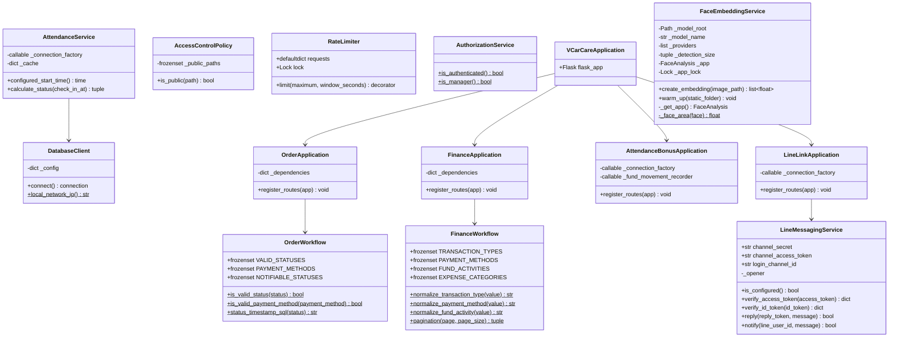
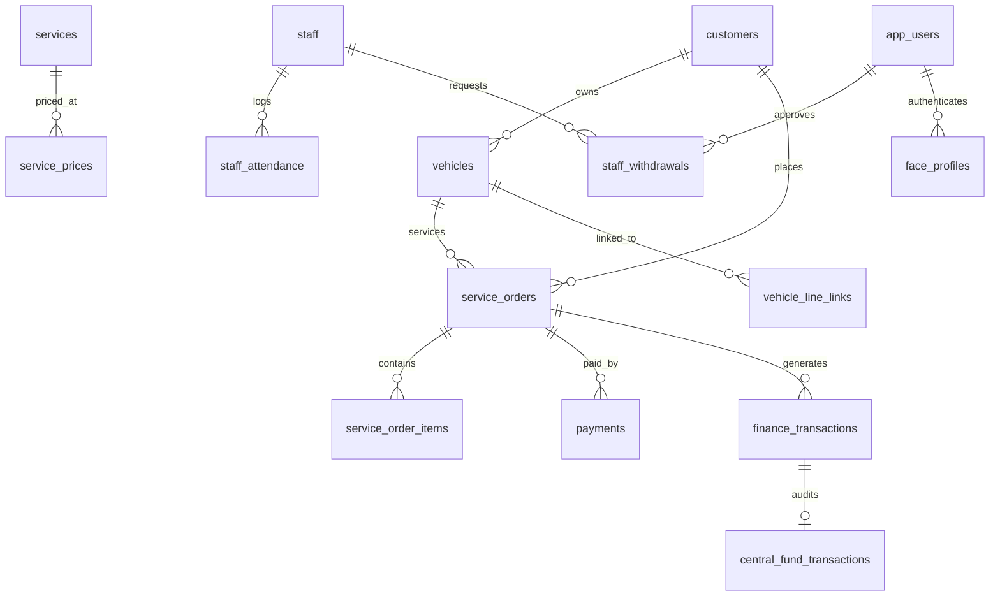

# คู่มือวิเคราะห์สถาปัตยกรรมและรีวิวโค้ดระบบ V-CarCare ฉบับสมบูรณ์
*(Comprehensive System Architecture, Class Hierarchy, Security, and Database Analysis)*

---

## 1. ภาพรวมสถาปัตยกรรมระบบ (System Architecture Overview)

ระบบ **V-CarCare** เป็นเว็บแอปพลิเคชันสำหรับบริหารจัดการธุรกิจคาร์แคร์แบบครบวงจร (POS, จัดการคิวล้างรถ, ระบบพนักงานและบันทึกเวลาด้วยการสแกนใบหน้า, ระบบบัญชีรายรับ-รายจ่ายและเงินกองกลาง, รวมถึงการแจ้งเตือนและติดตามสถานะผ่าน LINE Official Account)

สถาปัตยกรรมถูกออกแบบในรูปแบบ **Layered Architecture** ผสมผสาน **Object-Oriented Analysis & Design (OOAD)** ควบคู่กับ **Composition Root Pattern**:
- **Application Layer:** [`VCarCareApplication`](file:///c:/projects/v-carcare/src/backend/main.py#L66-L72) ทำหน้าที่เป็น Composition Root รวมระบบทั้งหมดเข้าด้วยกัน
- **Domain & Workflow Layer:** แบ่งแยกกฎทางธุรกิจออกจาก Route Handler ชัดเจน เช่น [`OrderWorkflow`](file:///c:/projects/v-carcare/src/backend/orders.py#L82-L106), [`FinanceWorkflow`](file:///c:/projects/v-carcare/src/backend/finance.py#L11-L40), [`AttendanceService`](file:///c:/projects/v-carcare/src/backend/attendance.py#L13-L47)
- **Security & Policy Layer:** ระบบรักษาความปลอดภัยแบบหลายชั้น (Defense-in-Depth) ตั้งแต่ [Access Control Policy](file:///c:/projects/v-carcare/src/backend/security/access_control.py), [Rate Limiting](file:///c:/projects/v-carcare/src/backend/security/rate_limit.py), และ [Argon2id Password Hashing Engine](file:///c:/projects/v-carcare/src/backend/security/password_hashing.py)
- **Integration Boundary:** เชื่อมต่อกับระบบภายนอกผ่าน Service เฉพาะทาง เช่น [`FaceEmbeddingService`](file:///c:/projects/v-carcare/src/backend/face_recognition.py#L17-L76) (InsightFace AI) และ [`LineMessagingService`](file:///c:/projects/v-carcare/src/backend/line_bot.py#L24-L126) (LINE Messaging API / LIFF)
- **Data Access Layer:** เข้าถึง PostgreSQL ผ่าน [`DatabaseClient`](file:///c:/projects/v-carcare/src/backend/database.py#L11-L28) พร้อม Connection Pool และ Transaction Management

---

## 2. เจาะลึกรายไฟล์และคลาสในระบบ (File & Class Deep Dive)



---

### 2.1 โครงสร้างไฟล์ราก (Root Directory Files)

#### 1. [`run.py`](file:///c:/projects/v-carcare/run.py)
* **หน้าที่:** จุดเริ่มต้นสำหรับรันแอปพลิเคชัน (Entry Point)
* **จุดสำคัญ:**
  * มีฟังก์ชัน `_ssl_context()` ทำหน้าที่สลับ HTTPS อัตโนมัติ: หากรันบน Cloud (Render) จะส่งผ่าน TLS termination แต่ถ้ารันบน Localhost จะโหลดใบรับรองจาก `.certs/vcarcare-cert.pem` หรือใช้โหมด `adhoc` เพื่อให้กล้องในบราวเซอร์เข้าถึง API WebRTC สำหรับสแกนหน้าได้
  * เรียก `warm_up_face_model()` เพื่อโหลดโมเดล AI ขึ้นหน่วยความจำล่วงหน้า
  * เรียก `start_auto_shop_open_scheduler()` เพื่อรัน Background Thread ตรวจสอบเวลาเปิดร้านและตั้งเงินทอนอัตโนมัติ

---

### 2.2 โมดูลระบบฐานข้อมูลและการตั้งค่า (Configuration & Database)

#### 2. [`src/backend/config.py`](file:///c:/projects/v-carcare/src/backend/config.py)
* **หน้าที่:** แหล่งรวมการตั้งค่าคงที่ (Constants) และการอ่าน Environment Variables
* **จุดสำคัญ:**
  * รองรับทั้งการต่อฐานข้อมูลแยกตัวแปร (`DB_HOST`, `DB_NAME`, ...) และการเชื่อมต่อผ่าน `DATABASE_URL` (พร้อมถอดรหัส URL encoding และบังคับ `sslmode=require`)
  * กำหนดค่าคงที่ทางธุรกิจ:
    * `FACE_MATCH_DISTANCE_THRESHOLD = 0.42`: เกณฑ์ Cosine Distance สำหรับการยืนยันใบหน้า
    * `WORK_START_TIME = time(8, 0)`: เวลาเริ่มงานมาตรฐาน (08:00 น.)
    * `STAFF_WITHDRAWAL_MAX_PER_REQUEST = 3000`: ลิมิตการเบิกเงินล่วงหน้าต่อครั้ง
    * `STAFF_WITHDRAWAL_MAX_REQUESTS_PER_WEEK = 2`: สิทธิ์การเบิกต่อสัปดาห์
    * `CENTRAL_FUND_OPENING_FLOAT = 3000`: จำนวนเงินทอนตั้งต้นประจำวัน
    * `THAI_SERVICE_NAMES`: พจนานุกรมแปลรหัสบริการเป็นภาษาไทย

#### 3. [`src/backend/database.py`](file:///c:/projects/v-carcare/src/backend/database.py)
* **คลาส `DatabaseClient`:**
  * **Attributes:**
    * `_config`: พารามิเตอร์การเชื่อมต่อ PostgreSQL
  * **Methods:**
    * `connect()`: คืนค่า Connection ของ `psycopg2` พร้อม `cursor_factory=RealDictCursor`
    * `local_network_ip()` (Static): ตรวจจับ IP จริงของเครื่องใน LAN ผ่าน UDP socket ไปยัง `8.8.8.8:80` (ไม่ส่งข้อมูลจริง) เพื่อให้แท็บเล็ตหรือเครื่องสแกนหน้าภายนอกรู้ URL ปลายทาง
  * **Facade Functions:** `get_db_connection()`, `get_local_network_ip()`

---

### 2.3 โมดูลความปลอดภัย (Security Modules)

#### 4. [`src/backend/security/password_hashing.py`](file:///c:/projects/v-carcare/src/backend/security/password_hashing.py)
* **หน้าที่:** กลไกการแฮชรหัสผ่านขั้นสูงระดับ Production
* **จุดสำคัญ:**
  * ใช้ **Argon2id** (OWASP Standard): `time_cost=3`, `memory_cost=65536` (64 MB), `parallelism=4`, `salt_len=16`, `hash_len=32`
  * **Dual-Layer Protection (HMAC + Pepper):** ฟังก์ชัน `_peppered_password()` นำรหัสผ่านมารวมกับ `PASSWORD_PEPPER` ผ่าน `HMAC-SHA256` ก่อนส่งเข้า Argon2id ป้องกันปัญหาเรื่องรหัสผ่านยาวเกินไปและเพิ่มความปลอดภัยหากฐานข้อมูลหลุด
  * **Legacy Migration:** ฟังก์ชัน `verify_legacy_werkzeug_password()` รองรับผู้ใช้เดิมที่เคยแฮชด้วย Werkzeug PBKDF2/Scrypt โดยจะยืนยันตัวตนได้และระบบจะแปลงเป็น Argon2id ทันทีผ่านฟังก์ชัน `_verify_and_upgrade_password()`

#### 5. [`src/backend/security/access_control.py`](file:///c:/projects/v-carcare/src/backend/security/access_control.py)
* **คลาส `AccessControlPolicy`:**
  * **Attributes:**
    * `_public_paths`: เซ็ต `frozenset` ของ Path ที่อนุญาตให้เรียกได้โดยไม่ต้องล็อกอิน (เช่น `/login`, `/health`, `/track`, `/callback`, `/api/track/orders`, `/api/liff/register`)
  * **Methods:**
    * `is_public(path)`: ตรวจสอบแบบ Normalization ตัด trailing slashes และตรวจ Regex-like prefix สำหรับ Route ติดตามสถานะและรูปสแตติก
* **ฟังก์ชัน `require_authenticated_routes()`:**
  * ทำหน้าที่เป็น **Default-Deny Access Gate** ใน Flask `before_request`: ทุกคำขอที่ไม่ใช่ Public Path และไม่มี `session['user_id']` จะถูกปฏิเสธทันที (ส่ง HTTP 401 ถ้าเป็น API หรือ Redirect ไป `/login` ถ้าเป็นหน้าเว็บ)

#### 6. [`src/backend/security/rate_limit.py`](file:///c:/projects/v-carcare/src/backend/security/rate_limit.py)
* **คลาส `RateLimiter`:**
  * **Attributes:**
    * `requests`: พจนานุกรม `defaultdict(deque)` เก็บ Timestamp ของแต่ละคำขอ แยกตามคีย์ `(function_name, client_ip)`
    * `lock`: `threading.Lock` ป้องกัน Race condition เมื่อมีหลาย Thread เข้ามาพร้อมกัน
  * **Methods:**
    * `limit(maximum, window_seconds)`: Decorator จำกัดความถี่แบบ Sliding Window ป้องกันการโจมตีแบบ Brute-Force หากส่งคำขอเกินกำหนดจะคืนค่า HTTP `429 Too Many Requests`

#### 7. [`src/backend/auth.py`](file:///c:/projects/v-carcare/src/backend/auth.py)
* **คลาส `AuthorizationService`:**
  * **Methods:**
    * `is_authenticated()`: ตรวจสอบความมีอยู่ของ Session `user_id`
    * `is_manager()`: ตรวจสอบสิทธิ์ว่าเป็นผู้จัดการ (`role == 'manager'`)
* **Decorators:**
  * `@login_required`: ป้องกัน Route สำหรับผู้ใช้ทั่วไป
  * `@manager_required`: บังคับสิทธิ์เฉพาะผู้จัดการ หากไม่ใช่จะส่ง HTTP 403 หรือ Redirect กลับหน้า POS พร้อมแจ้งเตือน

---

### 2.4 โมดูลงานบริการและกฎทางธุรกิจ (Business Logic & Workflows)

#### 8. [`src/backend/attendance.py`](file:///c:/projects/v-carcare/src/backend/attendance.py)
* **คลาส `AttendanceService`:**
  * **Attributes:**
    * `_connection_factory`: ฟังก์ชันเปิดการเชื่อมต่อ DB
    * `_cache`: ระบบ In-memory cache เวลาเปิดร้าน (`loaded_at`, `time`) มี TTL 60 วินาที เพื่อลดภาระการคิวรีฐานข้อมูล
  * **Methods:**
    * `configured_start_time()`: ดึงเวลาเข้างานจากตาราง `system_settings` (`auto_shop_open_time`) หากไม่มีจะใช้ `WORK_START_TIME` (08:00)
    * `calculate_status(check_in_at)`: คำนวณสถานะการลงเวลา:
      * ถ้า `check_in_at <= start_time` -> `on_time`, `late_minutes = 0`
      * ถ้า `check_in_at > start_time` -> `late`, คำนวณจำนวนนาทีที่สายจริง

#### 9. [`src/backend/face_recognition.py`](file:///c:/projects/v-carcare/src/backend/face_recognition.py)
* **คลาส `FaceEmbeddingService`:**
  * **Attributes:**
    * `_model_root`: โฟลเดอร์เก็บไฟล์โมเดล ONNX (`.models/`)
    * `_model_name`: `buffalo_sc`
    * `_detection_size`: ขนาดภาพตรวจจับ `(320, 320)`
    * `_app`: ตัวแปรเก็บอินสแตนซ์โมเดล InsightFace
    * `_app_lock`: Mutex Lock ป้องกันการ Initialize โมเดลซ้อนกันใน Multi-thread
  * **Methods:**
    * `_get_app()`: โครงสร้างแบบ **Double-Checked Locking Singleton** โหลดโมเดล InsightFace เมื่อจำเป็น (Lazy Loading)
    * `_face_area(face)`: คำนวณขนาด Bounding box ของใบหน้า
    * `create_embedding(image_path)`: ค้นหาใบหน้าที่ใหญ่ที่สุดในภาพ แล้วคืนค่า Normalised Vector 512 มิติ (`list[float]`)
    * `warm_up(static_folder)`: กระตุ้นการโหลดโมเดลเข้าหน่วยความจำตั้งแต่บูตระบบ

#### 10. [`src/backend/orders.py`](file:///c:/projects/v-carcare/src/backend/orders.py)
* **คลาส `OrderWorkflow` (Domain Rules):**
  * **Attributes:**
    * `VALID_STATUSES`: `pending`, `in_progress`, `drying`, `ready`, `completed`, `picked_up`, `cancelled`
    * `PAYMENT_METHODS`: `cash`, `transfer`, `card`, `other`
    * `NOTIFIABLE_STATUSES`: สถานะที่ต้องยิงแจ้งเตือนเข้า LINE (`in_progress`, `ready`, `completed`)
  * **Methods:**
    * `is_valid_status()`, `is_valid_payment_method()`
    * `status_timestamp_sql(status)`: กำหนดฟิลด์เวลาที่จะบันทึกเมื่อเปลี่ยนสถานะ (`started_at`, `completed_at`)
* **คลาส `OrderApplication` (Composition Root):**
  * ตรวจสอบ Dependency Injection ครบถ้วนก่อนลงทะเบียน Route
* **จุดสำคัญใน Route Handlers:**
  * ฟังก์ชัน `build_line_status_message()`: ประกอบ Flex Message สีสันสวยงามตามสถานะส่งหาลูกค้าทาง LINE
  * จัดการ Flow การชำระเงิน: เมื่อลูกค้าชำระเงิน จะบันทึกตาราง `payments` พร้อมทั้งส่งยอดเงินเข้า `finance_transactions` และส่งเงินสดเข้า `central_fund` โดยอัตโนมัติ

#### 11. [`src/backend/finance.py`](file:///c:/projects/v-carcare/src/backend/finance.py)
* **คลาส `FinanceWorkflow` (Domain Rules):**
  * ตรวจสอบความถูกต้องและจัดรูปแบบ (Normalize) ตัวกรองการเงิน: ประเภทรายการ (`income`, `expense`, `central_fund`), วิธีชำระเงิน (`cash`, `transfer`), และหมวดหมู่ค่าใช้จ่าย
* **คลาส `FinanceApplication` (Composition Root):**
  * รับ Dependency และลงทะเบียนระบบบัญชี
* **จุดสำคัญใน Route Handlers:**
  * **ระบบเงินทอนหน้าร้าน (Daily Cash Float):** ควบคุมการเปิดร้าน (`/api/central-fund/open`) โดยดึงเงิน 3,000 บาทจากกองกลางมาเป็นเงินทอน และการปิดร้าน (`/api/central-fund/close-cash-float`) นำเงินทอนพร้อมเงินสดที่รับระหว่างวันกลับคืนเข้ากองกลาง
  * **ระบบบัญชีคุมยอด (Central Fund Movement Ledger):** บันทึกการเพิ่ม/ลด/ปรับยอดเงินกองกลางทุกรายการอย่างโปร่งใส

#### 12. [`src/backend/staff.py`](file:///c:/projects/v-carcare/src/backend/staff.py)
* **คลาส `AttendanceBonusApplication`:**
  * ลงทะเบียน Endpoint คำนวณเบี้ยขยันประจำเดือน
* **จุดสำคัญใน Route Handlers:**
  * ฟังก์ชัน `attendance_bonus()`: คัดกรองพนักงานที่ได้เบี้ยขยัน โดยนับจำนวนวันที่มาทำงาน (`attended_days > 0`) และต้องไม่มีวันที่สาย ขาด หรือลาเลย (`disqualifying_days == 0`)
  * ฟังก์ชัน `pay_attendance_bonus()`: บันทึกการจ่ายเบี้ยขยันลงใน `attendance_bonus_payouts`, สร้างรายการรายจ่ายใน `finance_transactions`, และตัดยอดเงินกองกลางทันที

#### 13. [`src/backend/line_bot.py`](file:///c:/projects/v-carcare/src/backend/line_bot.py)
* **คลาส `LineMessagingService`:**
  * **Attributes:**
    * `channel_secret`, `channel_access_token`, `login_channel_id`
  * **Methods:**
    * `verify_access_token(access_token)`: ตรวจสอบความถูกต้องของ Access Token กับ LINE OAuth
    * `verify_id_token(id_token)`: ถอดรหัสและตรวจสอบ JWT ID Token ที่ได้จาก LIFF SDK เพื่อยืนยันตัวตนลูกค้า
    * `reply(reply_token, message)`: ตอบกลับข้อความใน Webhook
    * `notify(line_user_id, message)`: ส่ง Push Notification หาผู้ใช้เป็นรายบุคคล

#### 14. [`src/backend/line_link.py`](file:///c:/projects/v-carcare/src/backend/line_link.py)
* **คลาส `LineLinkApplication`:**
  * ควบคุมการผูกรถกับบัญชี LINE
* **จุดสำคัญใน Route Handlers:**
  * **LIFF Registration Flow (`/api/liff/register`):** อนุญาตให้ลูกค้ากรอกทะเบียนรถและเบอร์โทรผ่านหน้าเว็บ LIFF เพื่อผูกบัญชี LINE กับรถได้ทันที
  * **Conversational Webhook State Machine (`/callback`):** บอทโต้ตอบผ่าน LINE Chat โดยจำสถานะการสนทนาในตาราง `line_registration_sessions` เพื่อให้ลูกค้าพิมพ์ ทะเบียนรถ -> จังหวัด -> เบอร์โทร ในแชทได้

#### 15. [`src/backend/main.py`](file:///c:/projects/v-carcare/src/backend/main.py)
* **คลาส `VCarCareApplication`:**
  * ประกอบร่าง Flask App, กำหนด Path ของ Jinja Template และ Static File, ตั้งค่า Session Cookie Security, และเปิดใช้งาน CORS
* **จุดสำคัญในไฟล์:**
  * **Scheduler เปิดร้านอัตโนมัติ (`_auto_shop_open_loop`):** Background Daemon Thread ที่ทำงานทุกนาที ตรวจสอบว่าถึงเวลาเปิดร้านที่ผู้จัดการตั้งไว้หรือไม่ และทำการเปิดร้านพร้อมดึงเงินทอนให้โดยอัตโนมัติ
  * **ระบบสแกนใบหน้าเข้า-ออกงานและรีเซ็ตรหัสผ่าน:**
    * `face_login()`: ตรวจสอบใบหน้าเพื่อล็อกอินเข้าสู่ระบบ
    * `staff_face_checkout()`: สแกนหน้าเพื่อบันทึกเวลาเลิกงาน
    * `verify_password_reset_face()` & `reset_password_with_face()`: ให้ผู้จัดการสแกนหน้าเพื่อรีเซ็ตรหัสผ่านเมื่อลืมรหัสผ่าน
    * มีการตรวจสอบ Terminal IP เพื่อความปลอดภัย

---

## 3. สถาปัตยกรรมความปลอดภัยและการจัดเก็บข้อมูล (Security Architecture & Storage)

ระบบความปลอดภัยแบ่งออกเป็น 6 มิติหลัก:

```
[ ผู้ใช้ส่งคำขอ ]
       │
       ▼
1. Rate Limiting (จำกัดความถี่ต่อ IP + Thread Safe Lock)
       │
       ▼
2. Access Control Gate (Default-Deny Policy: ดักจับ Route ทั้งหมด)
       │
       ▼
3. Role-Based Access Control (RBAC: session['role'] == manager / staff)
       │
       ▼
4. ระบบยืนยันตัวตน (Authentication & Biometrics)
   ├── รหัสผ่าน: Argon2id + HMAC-SHA256 (Secret Pepper) + Dynamic Salt
   ├── สแกนหน้า: InsightFace (Buffalo_sc) + ตรวจสอบ Primary Terminal IP
   ├── LINE Tokens: LIFF JWT Signature Verification & Token Expiry
   └── การเงิน: Double-entry Audit Ledger (บันทึกยอดก่อน-หลังเสมอ)
```

### รายละเอียดการจัดเก็บในฐานข้อมูล:

| หมวดความปลอดภัย | เทคโนโลยีที่ใช้ | ตารางและคอลัมน์ใน Database ที่จัดเก็บ | มาตรการป้องกันและความปลอดภัย |
|---|---|---|---|
| **รหัสผ่านผู้ใช้** | **Argon2id** (64MB, 3 iterations) + HMAC-SHA256 Pepper | `app_users.password_hash` (TEXT) | แฮชถูกเข้ารหัสด้วย Salt สุ่ม 16 bytes ในรูปแบบ PHC string และใช้ Pepper จากตัวแปร Environment นอกฐานข้อมูล ป้องกัน Rainbow Table และ GPU Cracking |
| **ข้อมูลใบหน้า** | **InsightFace** (Cosine Distance Threshold <= 0.42) | `face_profiles.embedding` (BYTEA) และ `face_profiles.image_path` (TEXT) | แปลงใบหน้าเป็น Normalized Vector 512 มิติ และแปลงเป็น JSON Bytes เก็บในฐานข้อมูล รูปภาพจริงเก็บในโฟลเดอร์จำกัดสิทธิ์ |
| **จำกัดสิทธิ์เครื่องสแกน** | Primary Terminal IP Whitelisting | `system_settings` (setting_key = 'primary_face_scan_ip') | สแกนหน้าได้เฉพาะเครื่องที่ลงทะเบียนเป็นเครื่องหลักของร้านเท่านั้น ป้องกันการแอบถ่ายรูปสแกนจากนอกร้าน |
| **คุกกี้เซสชัน** | Flask Signed Cookies | เก็บฝั่ง Client Browser | บังคับแฟล็ก `HttpOnly=True` (กัน XSS ขโมยคุกกี้), `SameSite='Lax'` (กัน CSRF), และ `Secure=True` เมื่อรันบน HTTPS |
| **การเชื่อมต่อ LINE** | Secure Token & State Machine | `vehicle_line_links.link_token`, `expires_at`, `revoked_at` | โทเค็นผูกรถถูกสร้างแบบสุ่ม ปลอดภัย มีวันหมดอายุ และมีคำสั่งเพิกถอนสิทธิ์ได้ทันที |
| **บัญชีเงินกองกลาง** | Immutable Movement Ledger | `central_fund_transactions` (`balance_before`, `balance_after`, `created_by`) | บันทึกประวัติยอดเงินก่อนและหลังเปลี่ยนแปลงทุกครั้งพร้อมผู้กระทำ ห้ามอัปเดตยอดเงินลอยๆ |

---

## 4. โครงสร้างฐานข้อมูลอย่างละเอียดทั้ง 21 ตาราง (Database Schema)

ฐานข้อมูลประกอบด้วย 21 ตารางที่ทำงานสอดประสานกัน:

### 4.1 ตารางระบบผู้ใช้และพนักงาน (Users & Staff)
1. **`app_users`**
   * บัญชีผู้ใช้งานระบบ (ผู้จัดการ และ พนักงาน)
   * **คอลัมน์สำคัญ:** `id` (PK), `username`, `password_hash`, `role` (CHECK: 'manager', 'staff'), `staff_id` (FK -> `staff.id`), `is_active`, `created_at`
2. **`staff`**
   * ทะเบียนประวัติพนักงาน
   * **คอลัมน์สำคัญ:** `id` (PK), `employee_code`, `full_name`, `phone`, `role`, `daily_wage`, `is_active`, `created_at`
3. **`staff_attendance`**
   * บันทึกการลงเวลาเข้า-ออกงาน
   * **คอลัมน์สำคัญ:** `id` (PK), `staff_id` (FK -> `staff.id`), `work_date`, `check_in_at`, `check_out_at`, `status` (CHECK: 'on_time', 'late', 'leave', 'absent'), `late_minutes`
4. **`face_profiles`**
   * ข้อมูลเวกเตอร์ใบหน้าสำหรับสแกนเข้าสู่ระบบ
   * **คอลัมน์สำคัญ:** `id` (PK), `staff_id` (FK), `app_user_id` (FK), `image_path`, `embedding` (BYTEA), `model_name`, `created_at`
5. **`staff_withdrawals`**
   * ประวัติการขอเบิกเงินล่วงหน้าของพนักงาน
   * **คอลัมน์สำคัญ:** `id` (PK), `staff_id` (FK), `request_amount`, `approved_amount`, `withdraw_week`, `withdraw_year`, `status` ('pending', 'approved', 'rejected', 'paid', 'cancelled'), `approved_by` (FK -> `app_users.id`)
6. **`attendance_bonus_payouts`**
   * ประวัติการจ่ายเงินเบี้ยขยัน
   * **คอลัมน์สำคัญ:** `id` (PK), `staff_id` (FK), `bonus_month`, `amount`, `finance_transaction_id` (FK), `approved_by` (FK), `created_at`

---

### 4.2 ตารางลูกค้าและยานพาหนะ (Customers & Vehicles)
7. **`customers`**
   * ข้อมูลลูกค้า
   * **คอลัมน์สำคัญ:** `id` (PK), `full_name`, `phone` (Unique per customer lookup), `line_id`, `created_at`
8. **`vehicles`**
   * ทะเบียนและข้อมูลยานพาหนะ
   * **คอลัมน์สำคัญ:** `id` (PK), `customer_id` (FK -> `customers.id`), `license_plate`, `province`, `category` (S, M, L, XL, XXL), `size_code`, `brand`, `model`, `color`
9. **`vehicle_edit_history`**
   * ประวัติการแก้ไขข้อมูลรถ (Audit Log)
   * **คอลัมน์สำคัญ:** `id` (PK), `vehicle_id` (FK), `customer_id` (FK), `before_data` (JSONB), `after_data` (JSONB), `edited_by` (FK -> `app_users.id`), `edited_at`

---

### 4.3 ตารางบริการและโปรโมชั่น (Services & Pricing)
10. **`services`**
    * แคตตาล็อกบริการของคาร์แคร์
    * **คอลัมน์สำคัญ:** `id` (PK), `code`, `name`, `category`, `estimated_minutes`, `is_active`
11. **`service_prices`**
    * ตารางกำหนดราคาบริการตามขนาดรถ
    * **คอลัมน์สำคัญ:** `id` (PK), `service_id` (FK -> `services.id`), `category` (ขนาดรถ เช่น S, M, L), `price`
12. **`promotions`**
    * แคมเปญส่วนลดและโปรโมชั่น
    * **คอลัมน์สำคัญ:** `id` (PK), `name`, `description`, `discount_type` ('percent', 'fixed'), `discount_value`, `starts_at`, `ends_at`, `is_active`

---

### 4.4 ตารางคำสั่งซื้อและการชำระเงิน (Orders & Payments)
13. **`service_orders`**
    * คำสั่งซื้อหลัก (คิวบริการ)
    * **คอลัมน์สำคัญ:** `id` (PK), `queue_no`, `vehicle_id` (FK), `customer_id` (FK), `total_amount`, `discount_amount`, `net_amount`, `payment_method`, `status` ('pending', 'in_progress', 'drying', 'ready', 'completed', 'picked_up', 'cancelled'), `damage_note`, `started_at`, `completed_at`
14. **`service_order_items`**
    * รายการบริการย่อยที่เลือกลงในออเดอร์
    * **คอลัมน์สำคัญ:** `id` (PK), `order_id` (FK -> `service_orders.id`), `service_id` (FK), `service_code`, `service_name`, `price`
15. **`payments`**
    * บันทึกการชำระเงินของแต่ละออเดอร์
    * **คอลัมน์สำคัญ:** `id` (PK), `order_id` (FK -> `service_orders.id`), `method` ('cash', 'transfer', 'card', 'other'), `amount`, `paid_at`, `status` ('pending', 'paid', 'void')

---

### 4.5 ตารางการเงินและเงินกองกลาง (Finance & Central Fund)
16. **`finance_transactions`**
    * รายการเดินบัญชีรายรับ-รายจ่ายของร้าน
    * **คอลัมน์สำคัญ:** `id` (PK), `order_id` (FK), `staff_id` (FK), `transaction_type` ('income', 'expense'), `category`, `description`, `amount`, `payment_method`, `occurred_at`
17. **`central_fund`**
    * ยอดเงินกองกลางและเงินทอน (Singleton Row: `id = 1`)
    * **คอลัมน์สำคัญ:** `id` (PK=1), `balance`, `cash_float_balance`, `opening_balance`, `shop_opened_at`, `updated_at`
18. **`central_fund_transactions`**
    * บันทึกความเคลื่อนไหวเงินกองกลางแบบละเอียด
    * **คอลัมน์สำคัญ:** `id` (PK), `movement_type` ('income', 'expense', 'opening_float', 'closing_float', 'adjustment', 'fund_received'), `amount`, `balance_before`, `balance_after`, `description`, `finance_transaction_id` (FK), `created_by` (FK -> `app_users.id`), `opening_date`, `occurred_at`

---

### 4.6 ตารางระบบ LINE และการตั้งค่า (LINE Integration & Settings)
19. **`vehicle_line_links`**
    * ความสัมพันธ์ระหว่างรถกับบัญชี LINE ของลูกค้า
    * **คอลัมน์สำคัญ:** `id` (PK), `vehicle_id` (FK), `customer_id` (FK), `line_user_id`, `link_token`, `linked_at`, `expires_at`, `revoked_at`
20. **`line_registration_sessions`**
    * Session State การสนทนาลงทะเบียนรถผ่าน LINE Chatbot
    * **คอลัมน์สำคัญ:** `line_user_id` (PK), `step`, `license_plate`, `province`, `phone`, `updated_at`
21. **`system_settings`**
    * คอนฟิกระบบแบบ Key-Value
    * **คอลัมน์สำคัญ:** `setting_key` (PK), `setting_value`, `updated_at`

---

## 5. การวิเคราะห์การเชื่อมโยงตารางและการ JOIN ในระบบ (In-Depth Join Analysis)

ในระบบ V-CarCare มีการทำ SQL JOIN รวมทั้งหมด **11 จุดสำคัญ**:



---

### รายละเอียดการ JOIN ในแต่ละจุด:

#### 1. การดึงรายการออเดอร์ในหน้าคิวและประวัติ (Order Queue & History)
* **ไฟล์:** [`src/backend/orders.py`](file:///c:/projects/v-carcare/src/backend/orders.py#L171-L174)
* **คำสั่ง SQL:**
  ```sql
  SELECT o.id AS order_id, o.queue_no, o.status, o.total_amount,
         v.license_plate, v.province, v.category AS vehicle_category,
         c.phone
  FROM service_orders o
  JOIN vehicles v ON o.vehicle_id = v.id
  JOIN customers c ON o.customer_id = c.id
  ```
* **คู่คีย์ที่ JOIN:**
  * `service_orders.vehicle_id = vehicles.id`
  * `service_orders.customer_id = customers.id`
* **เหตุผลทางธุรกิจ:** คำสั่งซื้อเก็บเพียง ID อ้างอิง จึงต้อง JOIN ตาราง `vehicles` เพื่อนำเลขทะเบียน/หมวดหมู่ขนาดรถ และ JOIN ตาราง `customers` เพื่อนำเบอร์โทรติดต่อมาแสดงผลบนกระดานคิว

---

#### 2. การค้นหาผู้ใช้ LINE เพื่อยิงแจ้งเตือนสถานะรถ (LINE Push Notification)
* **ไฟล์:** [`src/backend/orders.py`](file:///c:/projects/v-carcare/src/backend/orders.py#L226-L230)
* **คำสั่ง SQL:**
  ```sql
  SELECT l.line_user_id, v.license_plate
  FROM service_orders o
  JOIN vehicles v ON v.id = o.vehicle_id
  JOIN vehicle_line_links l ON l.vehicle_id = v.id
  WHERE o.id = %s 
    AND l.line_user_id IS NOT NULL 
    AND l.revoked_at IS NULL 
    AND l.expires_at > NOW();
  ```
* **คู่คีย์ที่ JOIN:**
  * `service_orders.vehicle_id = vehicles.id`
  * `vehicle_line_links.vehicle_id = vehicles.id`
* **เหตุผลทางธุรกิจ:** เมื่อพนักงานกดเปลี่ยนสถานะเป็น "กำลังล้าง" หรือ "ล้างเสร็จแล้ว" ระบบจะ JOIN ข้ามจากออเดอร์ไปยังรถ แล้วค้นหาว่ารถคันนี้ผูกอยู่กับ LINE User ID ใดที่มีสิทธิ์ถูกต้องและยังไม่หมดอายุ เพื่อส่ง Flex Message แจ้งเตือนลูกค้าแบบ Real-time

---

#### 3. การออกรายงานรายรับ-รายจ่ายและรายการเดินบัญชี (Finance Ledger)
* **ไฟล์:** [`src/backend/finance.py`](file:///c:/projects/v-carcare/src/backend/finance.py#L158-L162)
* **คำสั่ง SQL:**
  ```sql
  SELECT f.id, f.transaction_type, f.category, f.amount, f.occurred_at,
         COALESCE(f.payment_method, p.method) AS payment_method,
         v.license_plate AS vehicle_plate
  FROM finance_transactions f
  LEFT JOIN payments p ON p.order_id = f.order_id AND p.status = 'paid'
  LEFT JOIN service_orders o ON o.id = f.order_id
  LEFT JOIN vehicles v ON v.id = o.vehicle_id
  ```
* **คู่คีย์ที่ JOIN:**
  * `finance_transactions.order_id = payments.order_id`
  * `finance_transactions.order_id = service_orders.id`
  * `service_orders.vehicle_id = vehicles.id`
* **เหตุผลทางธุรกิจ:** ใช้ `LEFT JOIN` 3 ชั้น เพื่อดึงรายละเอียดว่ารายรับแต่ละก้อนเกิดขึ้นจากออเดอร์ใด ชำระด้วยวิธีไหน (เงินสด/โอน) และมาจากรถทะเบียนอะไร โดยที่รายการรายจ่ายทั่วไป (เช่น ค่าอุปกรณ์) ที่ไม่มีเลขออเดอร์จะยังคงแสดงผลได้ครบถ้วน

---

#### 4. การดึงราคาบริการตามขนาดของรถ (Service Pricing per Vehicle Category)
* **ไฟล์:** [`src/backend/orders.py`](file:///c:/projects/v-carcare/src/backend/orders.py#L437-L440)
* **คำสั่ง SQL:**
  ```sql
  SELECT s.id AS service_id, s.code, s.name, s.estimated_minutes, sp.price
  FROM services s
  JOIN service_prices sp ON s.id = sp.service_id
  WHERE sp.category = %s AND s.is_active = TRUE;
  ```
* **คู่คีย์ที่ JOIN:**
  * `services.id = service_prices.service_id`
* **เหตุผลทางธุรกิจ:** เนื่องจากรถแต่ละขนาด (S, M, L, XL, XXL) มีอัตราค่าบริการต่างกัน การ JOIN นี้ช่วยให้ระบบ POS ดึงเฉพาะราคาที่ตรงกับขนาดของรถคันที่กำลังเปิดบิลได้อย่างถูกต้อง

---

#### 5. การยืนยันตัวตนด้วยใบหน้า (Face Login & Identification)
* **ไฟล์:** [`src/backend/main.py`](file:///c:/projects/v-carcare/src/backend/main.py#L273-L277)
* **คำสั่ง SQL:**
  ```sql
  SELECT fp.id, fp.app_user_id, fp.staff_id, fp.embedding, au.role, au.username
  FROM face_profiles fp
  JOIN app_users au ON au.id = fp.app_user_id
  WHERE au.is_active = TRUE;
  ```
* **คู่คีย์ที่ JOIN:**
  * `face_profiles.app_user_id = app_users.id`
* **เหตุผลทางธุรกิจ:** เมื่อกล้องตรวจจับใบหน้าได้ เวกเตอร์ใบหน้าจะถูกนำมาจับคู่กับข้อมูลใน `face_profiles` และ JOIN เข้ากับ `app_users` เพื่อนำ Role และ Username ไปสร้าง Session เข้าสู่ระบบให้ผู้ใช้ทันที

---

#### 6. การดึงข้อมูลพนักงานพร้อมเวลาเข้างานประจำวัน (Daily Staff Attendance)
* **ไฟล์:** [`src/backend/main.py`](file:///c:/projects/v-carcare/src/backend/main.py#L1465-L1470)
* **คำสั่ง SQL:**
  ```sql
  SELECT s.id, s.employee_code, s.full_name, s.role, s.daily_wage,
         sa.check_in_at, sa.check_out_at, sa.status, sa.late_minutes
  FROM staff s
  LEFT JOIN staff_attendance sa ON sa.staff_id = s.id AND sa.work_date = %s
  WHERE s.is_active = TRUE;
  ```
* **คู่คีย์ที่ JOIN:**
  * `staff.id = staff_attendance.staff_id`
* **เหตุผลทางธุรกิจ:** ใช้ `LEFT JOIN` เพื่อให้หน้าจอแดชบอร์ดแสดงรายชื่อพนักงานที่กำลังปฏิบัติงานทุกคน แม้ว่าพนักงานบางคนจะยังไม่ได้สแกนนิ้ว/สแกนหน้าเข้างานในวันนั้นก็ตาม

---

#### 7. การตรวจสอบการเบิกเงินล่วงหน้าของพนักงาน (Staff Advance Withdrawals)
* **ไฟล์:** [`src/backend/main.py`](file:///c:/projects/v-carcare/src/backend/main.py#L2424-L2427)
* **คำสั่ง SQL:**
  ```sql
  SELECT sw.*, s.full_name AS staff_name, s.employee_code,
         approver.username AS approver_name
  FROM staff_withdrawals sw
  JOIN staff s ON s.id = sw.staff_id
  LEFT JOIN app_users approver ON approver.id = sw.approved_by;
  ```
* **คู่คีย์ที่ JOIN:**
  * `staff_withdrawals.staff_id = staff.id`
  * `staff_withdrawals.approved_by = approver.id` (ตาราง `app_users`)
* **เหตุผลทางธุรกิจ:** นำข้อมูลคำขอเบิกเงินมาจับคู่กับชื่อพนักงานผู้ขอ และแสดงชื่อผู้จัดการที่กดอนุมัติรายการ เพื่อความโปร่งใสในการตรวจสอบบัญชี

---

#### 8. การคำนวณเบี้ยขยันประจำเดือน (Attendance Bonus Qualification)
* **ไฟล์:** [`src/backend/staff.py`](file:///c:/projects/v-carcare/src/backend/staff.py#L86-L95)
* **คำสั่ง SQL:**
  ```sql
  SELECT s.id, s.employee_code, s.full_name,
         COUNT(sa.id) FILTER (WHERE sa.check_in_at IS NOT NULL) AS attended_days,
         COUNT(sa.id) FILTER (WHERE sa.status IN ('late', 'leave', 'absent') OR sa.check_in_at IS NULL) AS disqualifying_days,
         p.id AS payout_id, p.amount AS paid_amount, p.created_at AS paid_at
  FROM staff s
  LEFT JOIN staff_attendance sa ON sa.staff_id = s.id 
       AND sa.work_date >= %s AND sa.work_date < %s
  LEFT JOIN attendance_bonus_payouts p ON p.staff_id = s.id 
       AND p.bonus_month = %s
  WHERE s.is_active = true AND s.created_at::date < %s
  GROUP BY s.id, s.employee_code, s.full_name, p.id, p.amount, p.created_at;
  ```
* **คู่คีย์ที่ JOIN:**
  * `staff.id = staff_attendance.staff_id` (ช่วงวันที่ของเดือน)
  * `staff.id = attendance_bonus_payouts.staff_id` (เดือนเดียวกัน)
* **เหตุผลทางธุรกิจ:** ทำการประมวลผลประวัติเข้างานทั้งเดือนของพนักงานเพื่อหาว่าเข้าเกณฑ์เบี้ยขยันหรือไม่ (ต้องมาทำงานและไม่มีวันมาสาย/ขาด/ลา) และตรวจว่าได้รับเงินเบี้ยขยันของเดือนนั้นไปแล้วหรือยัง

---

#### 9. การค้นหาข้อมูลรถและประวัติเจ้าของรถ (Vehicle & Customer Lookup)
* **ไฟล์:** [`src/backend/orders.py`](file:///c:/projects/v-carcare/src/backend/orders.py#L617-L620)
* **คำสั่ง SQL:**
  ```sql
  SELECT v.id AS vehicle_id, v.license_plate, v.province, v.category, v.size_code,
         c.id AS customer_id, c.phone, c.full_name
  FROM vehicles v 
  JOIN customers c ON c.id = v.customer_id
  WHERE v.license_plate = %s AND v.province = %s;
  ```
* **คู่คีย์ที่ JOIN:**
  * `vehicles.customer_id = customers.id`
* **เหตุผลทางธุรกิจ:** ในหน้า POS เมื่อกรอกทะเบียนรถและจังหวัด ระบบจะดึงข้อมูลรถพร้อมชื่อและเบอร์โทรของเจ้าของรถขึ้นมาอัตโนมัติ ช่วยลดเวลาการคีย์ข้อมูลซ้ำ

---

#### 10. การตรวจสอบสิทธิ์การรีเซ็ตรหัสผ่านของผู้จัดการผ่านการสแกนหน้า
* **ไฟล์:** [`src/backend/main.py`](file:///c:/projects/v-carcare/src/backend/main.py#L992-L995)
* **คำสั่ง SQL:**
  ```sql
  SELECT au.id, au.username, au.role, s.full_name
  FROM app_users au 
  JOIN staff s ON s.id = au.staff_id
  WHERE au.id = %s;
  ```
* **คู่คีย์ที่ JOIN:**
  * `app_users.staff_id = staff.id`
* **เหตุผลทางธุรกิจ:** เมื่อผู้จัดการสแกนหน้าผ่านเพื่อขอรีเซ็ตรหัสผ่าน ระบบจะ JOIN ตรวจสอบว่าบัญชีนี้ผูกอยู่กับพนักงานคนใด เพื่อยืนยันตัวตนก่อนอนุญาตให้ตั้งรหัสผ่านใหม่

---

#### 11. การรวมบริการย่อยในคำสั่งซื้อ (Correlated Aggregation)
* **ไฟล์:** [`src/backend/orders.py`](file:///c:/projects/v-carcare/src/backend/orders.py#L167-L170)
* **คำสั่ง SQL:**
  ```sql
  SELECT o.id,
         COALESCE(
           (SELECT string_agg(soi.service_name, ' + ' ORDER BY soi.id)
            FROM service_order_items soi WHERE soi.order_id = o.id),
           ''
         ) AS services_summary
  FROM service_orders o;
  ```
* **คู่คีย์ที่เชื่อมโยง:**
  * `service_order_items.order_id = service_orders.id`
* **เหตุผลทางธุรกิจ:** รวมรายการบริการย่อยทั้งหมดในออเดอร์มาเป็นข้อความสรุปชุดเดียว (เช่น "ล้างสี + ดูดฝุ่น + เคลือบสี") สำหรับแสดงผลในตารางคิวและใบเสร็จ

---

## สรุปจุดเด่นของระบบ (System Architecture Highlights)

1. **สถาปัตยกรรมแบบแยกส่วน (Modularity):** แยกความรับผิดชอบชัดเจนระหว่าง Controller, Service Layer, Domain Validation, และ Infrastructure Adapter
2. **ความปลอดภัยมาตรฐานระดับสูง:** ใช้ Argon2id ร่วมกับ HMAC Pepper, ป้องกัน Brute-force ด้วย Rate Limiting แบบ In-memory Sliding Window, และบังคับ Default-Deny Access Gate
3. **การประมวลผลไบโอเมตริกที่มีประสิทธิภาพ:** InsightFace Buffalo_sc ทำงานแบบ Singleton Lazy-loading พร้อม Double-Checked Lock และ Cosine Distance Threshold สำหรับความแม่นยำสูง
4. **ความถูกต้องทางบัญชี:** ระบบเงินกองกลาง (Central Fund) ทำงานแบบ Double-Entry Ledger ไม่เปิดให้แก้ไขยอดเงินโดยตรง ทุกรายการต้องมี Transaction Id, ผู้กระทำ และบันทึกยอดก่อน-หลังเสมอ

