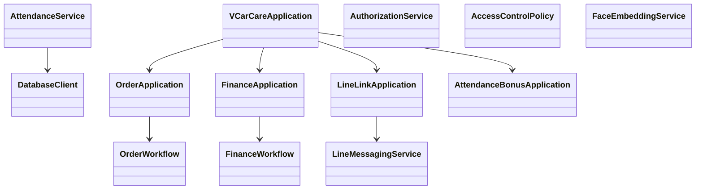

# Backend OOP architecture

Each Python module now has a focused object-oriented boundary while retaining
its previous public functions as compatibility facades where callers exist.

`config.py` remains a constants/configuration module intentionally: it has no
behaviour or mutable application workflow to encapsulate.
