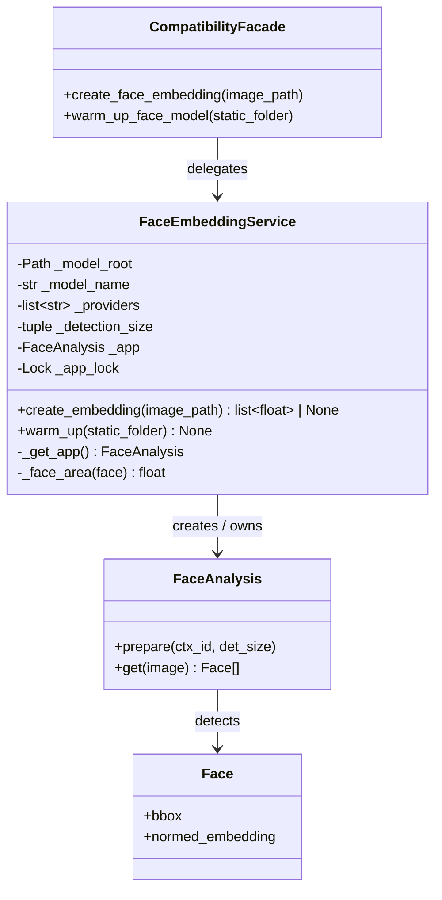
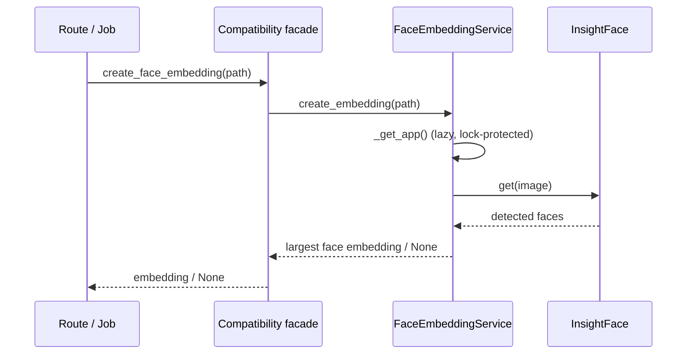

# Face recognition OOAD / UML

`FaceEmbeddingService` owns the model lifecycle and image-to-embedding use
case. Flask routes and the startup script retain the existing module-level
functions, which delegate to a shared service instance.

The service owns mutable model state, accepts injectable dependencies for
tests, and the facade isolates existing callers from the OOP refactor.
