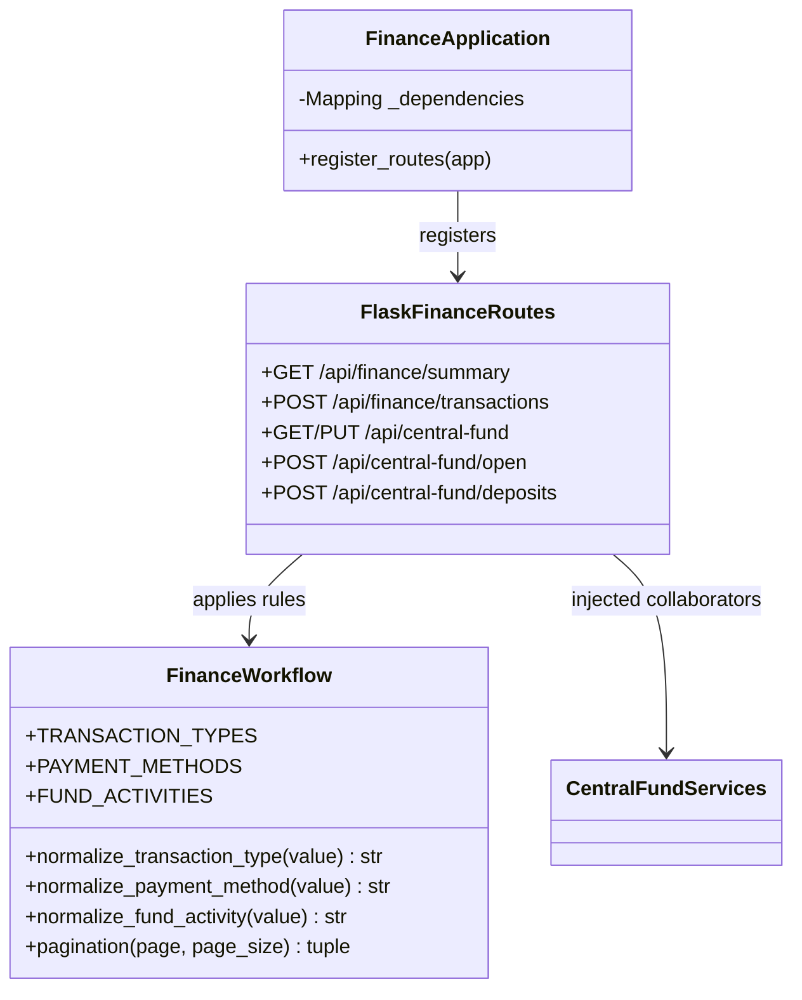

# Finance OOAD / UML

`FinanceApplication` is the composition root for finance routes. It validates
the collaborators provided by the main application and registers routes without
using mutable module globals. `FinanceWorkflow` contains request validation and
normalization rules shared by finance endpoints.

The previous `register_finance_routes(app, dependencies)` function remains as
a compatibility facade around `FinanceApplication`.
