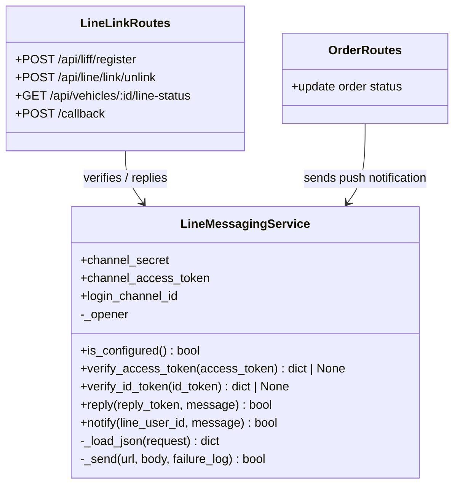

# LINE integration OOAD / UML

`LineMessagingService` is the integration boundary for LINE. It owns the
credentials, HTTP transport, token verification, webhook replies, and push
notifications. Flask handlers delegate to it rather than making HTTP calls.

The service accepts an injectable HTTP opener, so LINE interactions can be
tested without contacting the real API. Existing module-level functions in
`line_bot.py` are left available for backwards compatibility.
