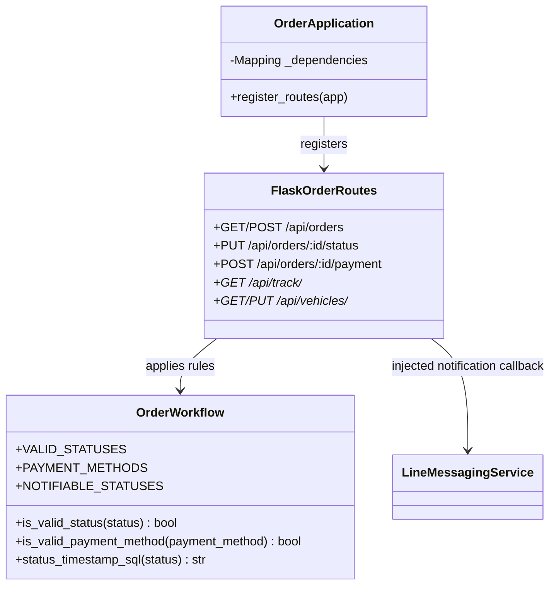

# Orders OOAD / UML

The order module now separates composition and domain rules from Flask route
registration. `OrderApplication` makes the dependencies supplied by the main
application explicit, while `OrderWorkflow` centralizes valid state and payment
rules used by order handlers.

The former `register_order_routes(app, dependencies)` API remains as a
compatibility facade around `OrderApplication`.
